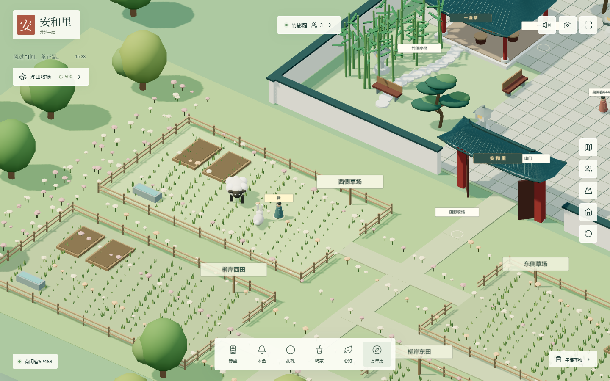

# 年禧 · 安和里

安和里独立开发项目，目标是以德宏为灵感的多人共同生活世界：每人有自己的角色，在共享村落安家、种养、经营，到瑞丽总佛寺祈福挂红结。当前已有可玩的本机微信小游戏预览、网页农场与匿名庭院相聚服务；共享地权、云存档和新世界多人尚未实现。此仓库不是整个年禧商城的生产源码。



## 快速运行

需要 Node.js 22.12 或更新版本。

```sh
npm ci
npm run dev:all
```

打开终端显示的本机地址，默认 `http://127.0.0.1:5173/`。此命令同时启动庭院页面与本机多人服务；退出时一起停止。支持中文与 `?locale=en` 英文界面。

小游戏浏览器试玩使用与微信相同的游戏入口：

```sh
npm run trial:minigame
```

默认 `http://127.0.0.1:5180/`。微信工程构建使用 `npm run build:wechat`，输出 `dist/wechat`。用户已确认 iPhone 预览可以进入庭院；真实账号与云端经营未接通，尚未正式发布。

Windows 用户的新项目、缓存和产物请放在 D:。本机协作目录是 `D:\CodexStorage\projects\nianxi-website`。安装前可设置：

```powershell
$env:TEMP='D:\CodexStorage\temp'
$env:TMP=$env:TEMP
$env:npm_config_cache='D:\CodexStorage\package-cache\npm'
npm ci
npm run dev:all
```

## 当前玩法

- 德宏世界原型：五地区与十个想象聚落选址、免费安家迁居、马匹资格与步行/骑马路线规划；路线为游戏设计值，尚未建设全州地形或跨区骑乘。

- 庭院：漫步、木鱼、念珠、静坐、礼拜、饮茶、双方同意后的邀茶、心灯、昼夜、留影。
- 山谷：四块可购买土地，每块容纳六只动物与两块菜畦；羊、兔、鸡会散步、停步吃草、抬头，喂食与抚摸时转向玩家回应。
- 小伙伴：免费取名，名字随个人牧场存档保留；牧场面板和场景照料栏均可修改。
- 养成：种牧草和萝卜、浇水、收获、喂养、收集产物、出售换安币、每日补给。
- 深山：步行到猎场，选择踪迹并完成射箭时机小游戏，无血腥表现。
- 原版玄枢万年历与自动罗盘原样保留，15 个文件有校验清单。

## 验证

```sh
npm test
npm run build
npm run build:wechat
npm run verify:calendar
npm run test:ui
```

UI 测试自动启动或复用本机 4107、4173、4183 三个服务。Windows 已安装标准路径 Chrome 时直接使用；其他环境先执行 `npx playwright install chromium`，或通过 `PLAYWRIGHT_CHROMIUM_EXECUTABLE_PATH` 指定浏览器。Windows 下载缓存也应放在 D:。

`integration/verify.mjs` 是可选历史基线审查，需要两份未随仓库上传的本地历史源码；普通开发、构建、单元测试和 UI 测试均不依赖这些目录。详细说明见 [接入说明](integration/README.md)。

## 协作

最新任务见 [2026-11-15 Muse 共享世界交接](docs/MUSE_SHARED_WORLD_HANDOFF_20261115.md)，总体方向见 [德宏世界框架](docs/DEHONG_WORLD_FRAMEWORK.md)。Codex 负责平台、身份、持久资产、联机与验收，Muse 负责地图、角色、细节、画面和客户端流程。首发免费，现数值保持，不充值、不接支付。

先阅读 [产品方向](docs/PRODUCT_INTENT.md)、[Muse 协作交接](docs/MUSE_HANDOFF.md) 与 [开发边界](AGENTS.md)。从 `origin/codex/dehong-world-framework` 最新提交建立各自功能分支，通过 Pull Request 返回；`main` 和 Muse 访问测试分支仍是旧基线。使用 ZIP 协作时标注基线提交并返回修改文件清单，合并前比较双方改动。

`integration/patch/` 仅是现有商城的安和里接入补丁，不可整体覆盖商城。支付、购物车、订单、会员、ERP、全局布局与数据库都不在本次修改范围。

## 数据说明

网页农场使用本机浏览器 `anheli-farm-v1` 存档；小游戏使用 `anheli-minigame-v2:save`，旧 `anheli-minigame-v1` 在校验后迁入且原数据保留。两者均非云资产，`cloudSynced:false`。当前不接真实支付、不兑换现金、不跨设备同步，也不与商城会员绑定。清除本机数据会删除对应进度。旧多人服务只同步访客活动与庭院互动；个人农场和动物尚未共享给其他玩家。

仓库不含生产凭证、数据库、浏览器登录资料、依赖或构建缓存。保留日历依赖与字体许可证。截图和临时报告在 `reports/`，不提交版本库。
