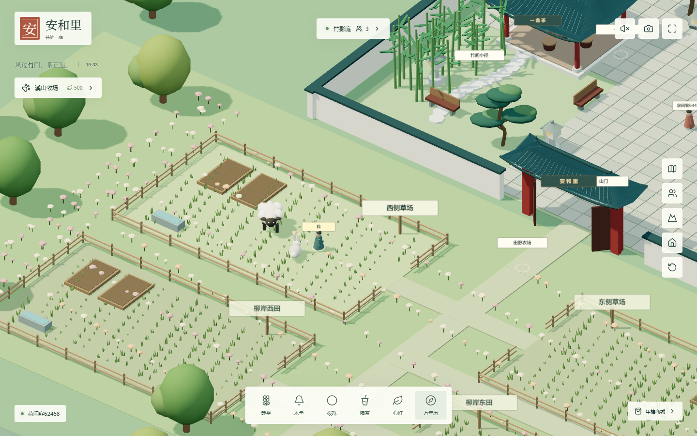

# 年禧 · 安和里

安和里庭院与溪山牧场的独立开发项目。当前包含可运行的 Three.js 世界、个人农场、轻量狩猎，以及庭院多人服务。此仓库不是整个年禧商城的生产源码；线上商城尚未部署这一版。



## 快速运行

需要 Node.js 22.12 或更新版本。

```sh
npm ci
npm run dev:all
```

打开终端显示的本机地址，默认 `http://127.0.0.1:5173/`。此命令同时启动庭院页面与本机多人服务；退出时一起停止。支持中文与 `?locale=en` 英文界面。

Windows 用户的新项目、缓存和产物请放在 D:。本机协作目录是 `D:\CodexStorage\projects\nianxi-website`。安装前可设置：

```powershell
$env:TEMP='D:\CodexStorage\temp'
$env:TMP=$env:TEMP
$env:npm_config_cache='D:\CodexStorage\package-cache\npm'
npm ci
npm run dev:all
```

## 当前玩法

- 庭院：漫步、木鱼、念珠、静坐、礼拜、饮茶、双方同意后的邀茶、心灯、昼夜、留影。
- 山谷：四块可购买土地，每块容纳六只动物与两块菜畦；羊、兔、鸡会散步、停步吃草、抬头，喂食与抚摸时转向玩家回应。
- 小伙伴：免费取名，名字随个人牧场存档保留；牧场面板和场景照料栏均可修改。
- 养成：种牧草和萝卜、浇水、收获、喂养、收集产物、出售换叶币、每日补给。
- 深山：步行到猎场，选择踪迹并完成射箭时机小游戏，无血腥表现。
- 原版玄枢万年历与自动罗盘原样保留，15 个文件有校验清单。

## 验证

```sh
npm test
npm run build
npm run verify:calendar
npm run test:ui
```

UI 测试自动启动或复用本机 4107、4173、4183 三个服务。Windows 已安装标准路径 Chrome 时直接使用；其他环境先执行 `npx playwright install chromium`，或通过 `PLAYWRIGHT_CHROMIUM_EXECUTABLE_PATH` 指定浏览器。Windows 下载缓存也应放在 D:。

`integration/verify.mjs` 是可选历史基线审查，需要两份未随仓库上传的本地历史源码；普通开发、构建、单元测试和 UI 测试均不依赖这些目录。详细说明见 [接入说明](integration/README.md)。

## 协作

先阅读 [产品方向](docs/PRODUCT_INTENT.md)、[Muse 协作交接](docs/MUSE_HANDOFF.md) 与 [开发边界](AGENTS.md)。从 `main` 建分支，通过 Pull Request 合并，避免两位协作者同时覆盖相同文件。使用 ZIP 协作时标注基线提交并返回修改文件清单，合并前比较双方改动。

`integration/patch/` 仅是现有商城的安和里接入补丁，不可整体覆盖商城。支付、购物车、订单、会员、ERP、全局布局与数据库都不在本次修改范围。

## 数据说明

农场使用本机浏览器 `anheli-farm-v1` 存档，叶币、土地、动物和狩猎奖励都是游戏数据。当前不接真实支付、不兑换现金、不跨设备同步，也不与商城会员绑定。清除站点数据会删除存档。多人服务只同步访客活动与庭院互动；个人农场和动物尚未共享给其他玩家。

仓库不含生产凭证、数据库、浏览器登录资料、依赖或构建缓存。保留日历依赖与字体许可证。截图和临时报告在 `reports/`，不提交版本库。
