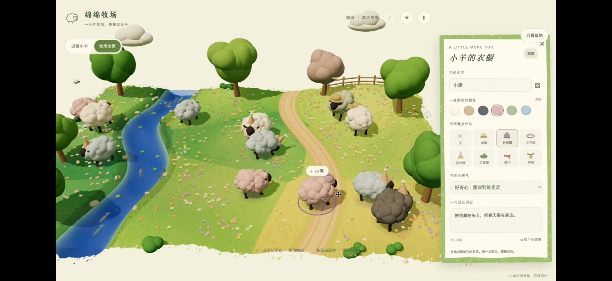

# 安和里：画面与寺院体验重新对齐

日期：2026-11-15。接收方：Muse。用户已明确要求 Codex 与 Muse 对齐本轮方向。

本文调整下一轮的优先级与验收方式，优先于旧交接中的扩图施工顺序；不重置现有玩法、存档或经济。当前可运行代码基线为 `codex/dehong-world-framework` 的 `8ca74d1cf21fc892b9b717ffda4a8cfaf62e7649`，后续先读取该分支实际最新提交。

## 用户要的感觉

用户原话：“我们要的画面感是如图的，可爱唯美，我们要的寺庙是如同这个网页的这个效果跟功能，为什么我们现在做出来的东西越来越不对劲呢。”

上图用于明确画面目标：圆润蓬松、有表情和个性的小动物；清亮草地、柔软岸线、小溪花木；舒服的斜俯视近景；名字、颜色和配饰让每一只动物可被认出。它是用户提供的视觉参考，不是安和里当前游戏截图，也不是待直接打包进游戏的美术资产。

寺院参考为 `https://sansatemple.com/`。用户提供的视频描述了合掌、礼拜、木鱼、佛珠与多人一起安静停留。本轮浏览器访问未能完成，Codex 没有核验该网站全部现行功能、在线人数或宣传数据；下面列的是安和里明确的体验要求。请 Muse 实际访问后补充已观察的功能、入口和交互，区分实测与视频描述。

核心定位仍是给年轻人一片可以休息、陪伴、安家的地方。大地图、自由安家、种养经营和邻居生活继续保留。下一轮先让一小片地方真正可爱、舒服、可玩，再把相同品质扩展到五坝。

## 当前偏差与新交付复核

当前微信基线的功能测试已经通过，但不等于画面与情绪体验达标。实看手机回归图并核对场景代码后，存在以下偏差：

- 牧场与家园动物仍以低分段球体、方腿等简单几何构成，缺少羊毛层次、面部表情和可辨认的个体。
- 牧场远距自动环绕、坝区近距跟随没有形成一致取景；部分家园视角被硬边竹楼或近处树冠占满。
- 大块地面与平涂材质缺少近景细节；夜晚细雨会进一步压暗，日常进入的画面与清亮参考差距大。
- 瑞丽已接入的是姐勒金塔短流程；独立总佛寺庭院尚未成为完整可参与的公共空间。
- 当前小游戏动物按品种数量存储，旧网页有的动物昵称、木鱼、佛珠和庭院服务不等于微信版已经接通。

本轮通过 GitHub API 读到了 Muse 最新提交 `17e23f0c51813b7b8f6b95b596a9cda5a96da83e` 及其提交文档。它在 `muse/shared-world-scenes` 上增加了可进入的大殿和五种动作，这部分可以复用，但尚未集成或由 Codex 运行验收：

1. **地点要纠正。** 当前实现写在 `mangshi-scene.cjs`，文档称“芒市总佛寺”。用户确认的是瑞丽总佛寺，公共中心必须落在瑞丽，姐勒金塔是另一地点。请复用大殿与动作实现，接入瑞丽正确入口和生活路线；仅把芒市的名字换成瑞丽不算完成。
2. **木鱼体验未完整。** Muse 明确交付的是纯视觉敲击，无声音。Muse 负责敲棒动作、反馈与音色素材，Codex 负责微信音频适配、静音和前后台生命周期；木鱼有声音并可静音后才算完整体验。
3. **瞬时动作也需要多人同步。** 本机动作可以先独立运行，但未来同场玩家需要看见合掌、坐下、礼拜等状态；不必把每一帧写入数据库，却不能说“不存在跨玩家同步问题”。位置、动作和离开状态走 Codex 同步契约，红结走持久记录。
4. **继承基线需重新对齐。** 该提交父链包含 `662be48` 的临路安家条件与 `fd514cb` 的距离地价，不能整分支覆盖当前试玩。当前用户要求资金足够、合法空地即可安家；美术纠偏不顺带更改价格或恢复临路门槛。

## 下一轮只交付一段完整样板

先在现有微信运行入口中完成瑞丽“家门口与牧场 → 村路/集市 → 总佛寺”的可玩样板。允许区块加载与室内切换，但出入口位置、返回位置、小地图和走路路线必须一致。已有五坝保留，暂缓向其他坝铺开同类新美术和更多功能。

| 部分 | Muse 交付 | Codex 配合与验收 |
| --- | --- | --- |
| 画面样板 | 一处竹楼、田地、溪流花草与圆润动物，统一材质、尺度、光线及镜头 | 接入现有微信宿主，验证手机可见性、输入、加载与性能 |
| 动物陪伴 | 一只完整羊的造型、走动、吃草、抬头、靠近反馈；免费取名和少量颜色/配饰界面 | 先明确稳定 animalId 与外观字段、迁移和事务保存；旧动物数量与产出不变 |
| 总佛寺 | 瑞丽入口、大殿/庭院、蒲团、动作、木鱼和念珠、红结固定锚点 | 交互状态、音频适配、退出/切后台恢复、保存与服务接入 |
| 多人准备 | 接收外部人物与动作投影，提供入座和离开视觉；不写假在线 | 身份、真实动作同步、频道与持久红结；接通前如实标明未完成 |

整体画面以用户参考为基准，不只换一套配色：动物有体积与软糯层次，脚下有柔和接地阴影；草地、小径和溪岸自然衔接；建筑可爱且清楚，玩家和动物在手机上足够大。近景能陪伴动物，拉远能认路，树与房屋不长时间挡住角色。夜景依旧能辨路、看清表情，不能只交正午图回避实际夜间体验。

动物外观模型可先通过明确标注的开发样例预览，但正式入口的名字、配饰与颜色必须跟随真实个体保存，重载和搬家后保持。Codex 冻结字段与迁移后再接持久化，不在动画回调随机创建动物资产。既有一只动物迁移后仍是一只，不改变旧余额或生产时钟。

## 寺院体验要求

- 自主合掌、礼拜、静坐；礼拜支持重复/自动进行并随时停止，静坐不被强制几秒后结束。计数如保留只作个人反馈，不关联收益、排行或任务门槛。
- 木鱼点击与动作、声音对应，可静音；念珠拨动有明确的手部和珠串反馈，开始、停止、走开均自然。
- 庭院与殿内都要有可以停留的构图、环境声与安静空间，操作控件不遮住人物和主体。音频在用户交互后启用，后台暂停，返回不叠音。
- 挂红结的动作与锚点由 Muse 交付，持久记录、重试与真实共享由 Codex 接入；旧两分钟心灯不能充当永久红结。
- 同场体验最终由两个真实连接验收：能看见彼此入座、动作和离开；未接服务时不展示虚构在线人数或假邻居。
- 寺院免费、自愿，与买地、种养和搬家互不设前置；现有经营数值、静心小确幸奖励保持，本轮不增加祈福收益。

## 分支与回归边界

Muse 保留自己的现有工作，从最新协作基线整理小步增量或 PR，不强推、不整包覆盖。重点保留 `wechat/platform/`、`createGame(context)`、单画布、触控/帧循环、原生 Canvas 和微信 r108 兼容修复。只改旧 `src/` 网页不能当作小游戏完成。

保留已交付的：新档 1000 安币、主动领取一次 3000 测试补给、当前地价与生产配置、可选修路、同坝/跨坝免费搬家、家当与作物时钟、旧址释放、小地图拖动/调大小/双指缩放及输入拦截、完整占地检查和树冠遮挡恢复。不新增等级、签到、任务、通路或祈福硬门槛。

此前发现的长角色名拼家名保存失败、坐标影响固定地报价、祈福阻塞重复播种仍需按最新代码复查并给回归证据，不能假定新寺院提交已自动解决。

商城其他模块、原日历和自动罗盘保持原样，不接真实支付，不部署、不微信提审。报告、截图、构建与测试存档留在项目 D 盘；公开仓库不提交真实玩家信息、凭据或本机存档。

## 交付与验收

1. Muse 先回复对上述方向的理解、实际开发基线、可复用的 `17e23f0` 部分、冲突文件与本轮具体交付范围。遇到接口缺口明确提出，Codex 补平台/数据能力，不能用功能缺失换“已完成”。
2. 提交代码分支/提交号、修改文件清单，以及同一游戏入口的手机/桌面实拍。至少包括牧场近景、家园全景、总佛寺外院与内景、昼夜对照；附一段连续操作录像或可复现试玩步骤。概念图仅用于沟通，不算运行证据。
3. 每次代码改动跑 `npm test`、`npm run build`、`npm run build:wechat`、`npm run verify:calendar`；场景/UI 改动再跑 `npm run test:ui`。现代 Three 与微信 r108 验证桌面、手机竖屏/横屏非空、动物移动、真实点击、布局和重载。
4. Codex 集成后检查 iPhone 微信运行、前后台音频、自由安家/迁居存档与旧功能回归。真实多人和持久红结单独记录服务接通证据，不拿单机动画替代。
5. 先把这块实际手机画面交用户确认“感觉对了”，再扩到五坝。视觉质量与完整体验是验收条件，测试通过和功能数量不能替代。

本轮是协作纠偏交接，尚未实施上述美术和寺院改造；Muse 已发布的实现与 Codex 当前已集成状态在上文分别列明。
